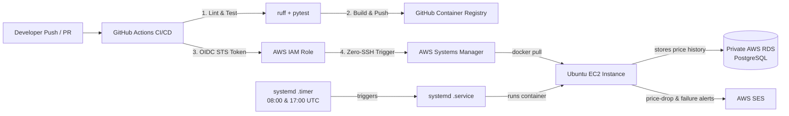

# PlayStation Store Price Tracker — Cloud-Native Infrastructure & CI/CD

An automated, containerized PlayStation Store price-tracking system provisioned end-to-end on AWS using **Terraform**, **Ansible**, **Docker**, **systemd**, and a **keyless GitHub Actions (OIDC + AWS SSM)** deployment pipeline.

---

## Architecture Overview



---

## Tech Stack & Engineering Highlights

| Layer | Technology | Implementation Details |
| :--- | :--- | :--- |
| **Infrastructure as Code** | **Terraform** | Two-stage bootstrap (`terraform/bootstrap` + main stack), remote S3 state with native state locking (`use_lockfile = true`), custom VPC, multi-AZ subnets, chained Security Groups, EC2, private RDS PostgreSQL, and scoped IAM roles. |
| **Configuration Management** | **Ansible** | Idempotent playbook (`ansible/playbook.yml`) configuring Docker CE, deploying `0600`-permissioned `.env` secrets via Jinja2 templates, and installing native `systemd` units. |
| **Scheduling & Runtime** | **Docker + systemd** | Playwright/Python 3.12 container (`mcr.microsoft.com/playwright/python:v1.61.0-noble`) triggered twice daily (`08:00` & `17:00 UTC`) via `scraper.timer` + `scraper.service` instead of cron for deterministic logging via `journalctl`. |
| **CI/CD & Security** | **GitHub Actions (OIDC + SSM)** | Runs `ruff` and `pytest` on PRs; builds & pushes SHA-tagged images to GHCR on `main`; deploys via AWS OIDC (`AssumeRoleWithWebIdentity`) and AWS SSM Run Command—no static AWS keys in GitHub Secrets. |
| **Application & Alerts** | **Python 3.12 + AWS SES** | Scrapes PlayStation Store titles, persists historical pricing in PostgreSQL, and sends HTML price-drop and failure notifications via AWS SES using the EC2 IAM Instance Profile. |

---

## Repository Structure

```text
.
├── .github/workflows/
│   └── ci-cd_workflow.yml      # Lint (ruff), test (pytest), GHCR build/push, OIDC + SSM deploy
├── terraform/
│   ├── bootstrap/              # Stage A: S3 remote state bucket
│   ├── backend.tf              # Stage B: S3 backend with native use_lockfile = true
│   ├── vpc.tf                  # Custom VPC, multi-AZ subnets, IGW, route tables
│   ├── security_group.tf       # Stateful EC2 SG + EC2-to-RDS chained PostgreSQL SG
│   ├── instance.tf             # Ubuntu EC2 compute
│   ├── rds.tf                  # Private PostgreSQL RDS instance
│   ├── iamrole.tf              # Scoped EC2 instance profile (SES + SSM)
│   └── github_oidc.tf          # GitHub Actions OIDC provider & deploy role
├── ansible/
│   ├── playbook.yml            # Ubuntu Docker CE setup, image pull, systemd unit deployment
│   └── templates/              # Jinja2 templates for .env, scraper.service, scraper.timer
├── scraper/
│   ├── scraper.py              # Playwright PS Store scraper
│   ├── db.py                   # PostgreSQL persistence layer
│   └── notifier.py             # AWS SES HTML email alerts (IAM role / AWS profile)
├── tests/
│   └── test_scraper.py         # Pytest unit tests
├── Dockerfile                  # Playwright Noble (Ubuntu 24.04) container image
└── pyproject.toml              # Ruff linting & pytest configuration
```

---

## Key Architectural Decisions

1. **Native S3 State Locking (`use_lockfile = true`):** Adopted Terraform 1.10+ native S3 state locking to eliminate DynamoDB table overhead while maintaining safe concurrent-apply protection.
2. **Keyless CI/CD via OIDC + SSM:** Replaced static `AWS_ACCESS_KEY_ID` secrets with short-lived STS tokens via GitHub OIDC, and replaced SSH-based deployments with AWS Systems Manager (`aws ssm send-command`).
3. **`systemd` Timers Over Cron:** Used `systemd` `.service` and `.timer` units (`Persistent=true`) so missed runs after host reboots catch up automatically and container stdout/stderr streams directly into `journalctl`.
4. **Chained Security Groups:** The RDS PostgreSQL Security Group accepts inbound port `5432` **only** from the EC2 Security Group ID—never from public CIDRs.
